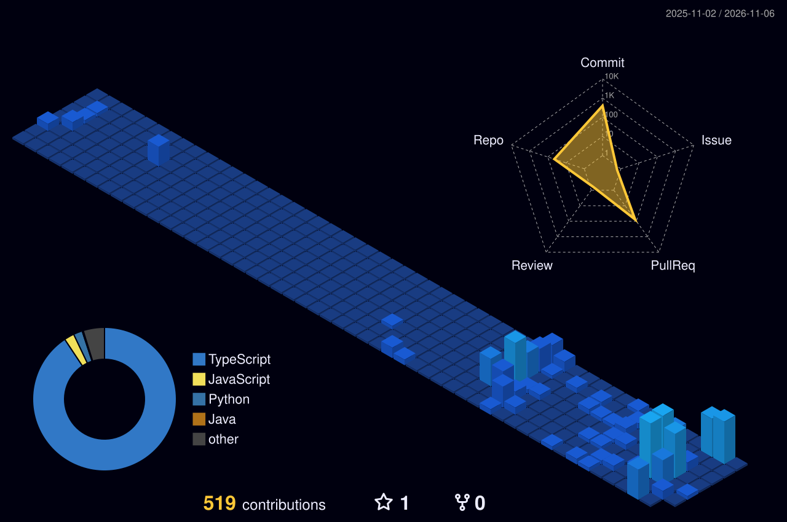

<div align="center">


<br/>


</div>

---

## 🌌 About

```yaml
name: ZUN
role: Software Engineering Student @ 충북대학교 소프트웨어학부 (3학년)
interests: [AI/ML, Data Engineering, Web Development, IoT]
currently:
  - 🪐 Asteron — 내가 본 영화가 별이 되는 3D 우주
  - ⚽ CLASS FC — 대학 축구 동아리 웹 플랫폼 운영
  - 🔥 EV 주차장 화재 조기경보 AI/IoT 시스템
goal: "10년 뒤에도 만들고 싶은 걸 만들 수 있는 개발자"
```

<div align="center">

</div>

---

## 🚀 Projects

<div align="center">

<a href="https://github.com/djkdb/star-movie">
  
</a>

</div>

<table>
<tr>
<td width="50%" valign="top">

### 🪐 Asteron
> 본 영화와 드라마가 하나의 별이 되어 나만의 우주를 채우는 3D 인터랙티브 웹

- 평점에 따라 별의 밝기와 블룸이 달라짐
- 별자리 그리기 모드로 취향 연결
- 불꽃 · 유성우 · 소행성 충돌 · 블랙홀 이펙트

`React Three Fiber` `Three.js` `Vite`

[**→ Repository**](https://github.com/djkdb/star-movie)

</td>
<td width="50%" valign="top">

### ⚽ CLASS FC
> 대학 축구 동아리를 위한 실서비스 웹 플랫폼

- 경기 일정 · 기록 · 선수 관리 시스템
- CI/CD 자동 배포 파이프라인 구축
- 프론트엔드 개발 및 팀 리딩

`React 18` `Node.js` `MySQL` `GitHub Actions`

[**→ classfc.com**](https://classfc.com)

</td>
</tr>
</table>

---

## 📊 Stats

<div align="center">


<br/>


<br/>


<br/>


</div>

---

## 🌠 Contribution Universe

<div align="center">

<!-- 3D 잔디 — .github/workflows/3d-contrib.yml 이 매일 생성 -->


<br/>

<!-- 잔디 뱀 — .github/workflows/snake.yml 이 output 브랜치에 생성 -->
<picture>
  <source media="(prefers-color-scheme: dark)" srcset="https://raw.githubusercontent.com/djkdb/djkdb/output/github-snake-dark.svg" />
  <source media="(prefers-color-scheme: light)" srcset="https://raw.githubusercontent.com/djkdb/djkdb/output/github-snake.svg" />
  
</picture>

</div>

---

## 🧩 Algorithm

<div align="center">

<!-- ⚠️ YOUR_BOJ_ID 를 백준 아이디로 바꾸세요 -->
[](https://solved.ac/tjdwns2121)

</div>

---

## ✍️ Latest Posts

<!-- BLOG-POST-LIST:START --><a href="https://satpuru.tistory.com/entry/%ED%81%B4%EB%A1%9C%EB%93%9C-%ED%8E%98%EC%9D%B4%EB%B8%94-52-%EC%B6%9C%EC%8B%9C-%EC%A0%95%EB%A6%AC-%EC%B4%88%EA%B8%B0%ED%99%94%EA%B6%8C-%EC%93%B0%EB%8A%94-%EB%B2%95%EA%B9%8C%EC%A7%80">클로드 페이블 5.2 출시 정리, 초기화권 쓰는 법까지</a> &nbsp;·&nbsp; <sub>2026.11.10</sub><br/><a href="https://satpuru.tistory.com/entry/%ED%81%B4%EB%A1%9C%EB%93%9C-%EC%BD%94%EB%93%9C-%EA%BF%80%EA%B8%B0%EB%8A%A5-16%EA%B0%80%EC%A7%80-design%EB%B6%80%ED%84%B0-ultrathink%EA%B9%8C%EC%A7%80">클로드 코드 꿀기능 16가지, /design부터 ultrathink까지</a> &nbsp;·&nbsp; <sub>2026.11.09</sub><br/><a href="https://satpuru.tistory.com/entry/%EA%B7%A4-10kg-%ED%99%9C%EC%9A%A9%EB%B2%95-%EB%84%A4%EC%9D%B4%EB%B2%84-AI%ED%83%AD-%ED%94%84%EB%A1%AC%ED%94%84%ED%8A%B8-%ED%95%98%EB%82%98%EB%A1%9C-%EB%B3%B4%EA%B4%80%EB%B6%80%ED%84%B0-%EB%A9%94%EB%89%B4%EA%B9%8C%EC%A7%80">귤 10kg 활용법, 네이버 AI탭 프롬프트 하나로 보관부터 메뉴까지</a> &nbsp;·&nbsp; <sub>2026.11.09</sub><br/><a href="https://satpuru.tistory.com/entry/%ED%94%BC%EC%A7%80%EC%BB%AC-AI%C2%B7%EC%86%8C%EB%B2%84%EB%A6%B0-AI-%EB%9C%BB-%E2%80%94-2026-GAIF%EB%A1%9C-%EB%B3%B4%EB%8A%94-AI-%EC%9A%A9%EC%96%B4-6%EA%B0%9C">피지컬 AI&amp;middot;소버린 AI 뜻 &amp;mdash; 2026 GAIF로 보는 AI 용어 6개</a> &nbsp;·&nbsp; <sub>2026.11.08</sub><br/><a href="https://satpuru.tistory.com/entry/%EC%B9%98%EC%9D%B4%EC%B9%B4%EC%99%80-%EB%9E%9C%EB%8D%A4-%EB%94%94%ED%8E%9C%EC%8A%A4-%EC%84%A4%EC%B9%98-%EC%97%86%EC%9D%B4-%EB%B0%94%EB%A1%9C-%ED%95%98%EB%8A%94-20%EC%9B%A8%EC%9D%B4%EB%B8%8C-%ED%8C%AC-%EA%B2%8C%EC%9E%84">치이카와 랜덤 디펜스, 설치 없이 바로 하는 20웨이브 팬 게임</a> &nbsp;·&nbsp; <sub>2026.11.04</sub><br/><!-- BLOG-POST-LIST:END -->

<div align="right">

[**→ 전체 글 보기**](https://satpuru.tistory.com)

</div>

---

## ⏱ Coding Activity

<!--START_SECTION:waka-->
<!-- 여기는 .github/workflows/waka.yml 이 자동으로 채웁니다 -->
<!--END_SECTION:waka-->

---


## 🏅 Certifications & Activities

- 📜 **ADsP** (데이터분석 준전문가)
- 🏢 **모두의 창업** 신속심사 통과 (EV 화재 조기경보 시스템)
- ⚽ **CLASS 축구동아리 회장**
- 🌐 **CLASS FC Official Website** 프로젝트 기획 및 개발
- 🤖 AI 기반 **블로그 자동화 시스템** 개발
- 🛍️ **네이버 쇼핑커넥트 · 쿠팡파트너스 자동 발행 플랫폼** 개발
- 🚗 **EV-SafePark** (전기차 화재 조기경보 시스템) 프로젝트 개발
- 
---

<div align="center">

### 📫 Contact

[](https://satpuru.tistory.com)
[](mailto:tjdwns2121@naver.com)
[](https://linkedin.com/in/성준-이-34024538a)

<br/> 

 

 

</div>
