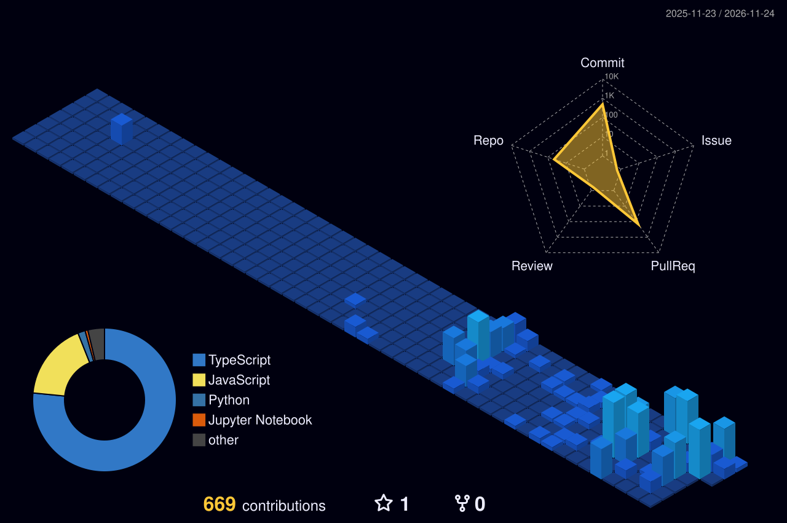

<div align="center">


<br/>


</div>

---

## 🌌 About

```yaml
name: ZUN
role: Software Engineering Student @ 충북대학교 소프트웨어학부 (3학년)
interests: [AI/ML, Data Engineering, Web Development, IoT]
currently:
  - 🪐 Asteron — 내가 본 영화가 별이 되는 3D 우주
  - ⚽ CLASS FC — 대학 축구 동아리 웹 플랫폼 운영
  - 🔥 EV 주차장 화재 조기경보 AI/IoT 시스템
goal: "10년 뒤에도 만들고 싶은 걸 만들 수 있는 개발자"
```

<div align="center">

</div>

---

## 🚀 Projects

<div align="center">

<a href="https://github.com/djkdb/star-movie">
  
</a>

</div>

<table>
<tr>
<td width="50%" valign="top">

### 🪐 Asteron
> 본 영화와 드라마가 하나의 별이 되어 나만의 우주를 채우는 3D 인터랙티브 웹

- 평점에 따라 별의 밝기와 블룸이 달라짐
- 별자리 그리기 모드로 취향 연결
- 불꽃 · 유성우 · 소행성 충돌 · 블랙홀 이펙트

`React Three Fiber` `Three.js` `Vite`

[**→ Repository**](https://github.com/djkdb/star-movie)

</td>
<td width="50%" valign="top">

### ⚽ CLASS FC
> 대학 축구 동아리를 위한 실서비스 웹 플랫폼

- 경기 일정 · 기록 · 선수 관리 시스템
- CI/CD 자동 배포 파이프라인 구축
- 프론트엔드 개발 및 팀 리딩

`React 18` `Node.js` `MySQL` `GitHub Actions`

[**→ classfc.com**](https://classfc.com)

</td>
</tr>
</table>

---

## 📊 Stats

<div align="center">


<br/>


<br/>


<br/>


</div>

---

## 🌠 Contribution Universe

<div align="center">

<!-- 3D 잔디 — .github/workflows/3d-contrib.yml 이 매일 생성 -->


<br/>

<!-- 잔디 뱀 — .github/workflows/snake.yml 이 output 브랜치에 생성 -->
<picture>
  <source media="(prefers-color-scheme: dark)" srcset="https://raw.githubusercontent.com/djkdb/djkdb/output/github-snake-dark.svg" />
  <source media="(prefers-color-scheme: light)" srcset="https://raw.githubusercontent.com/djkdb/djkdb/output/github-snake.svg" />
  
</picture>

</div>

---

## 🧩 Algorithm

<div align="center">

<!-- ⚠️ YOUR_BOJ_ID 를 백준 아이디로 바꾸세요 -->
[](https://solved.ac/tjdwns2121)

</div>

---

## ✍️ Latest Posts

<!-- BLOG-POST-LIST:START --><a href="https://satpuru.tistory.com/entry/thinking-orbs-%EC%82%AC%EC%9A%A9%EB%B2%95-%EC%9B%B9%EC%82%AC%EC%9D%B4%ED%8A%B8-%EB%A1%9C%EB%94%A9-%EB%AA%A8%EC%85%98-%EC%98%A4%ED%94%88%EC%86%8C%EC%8A%A4-%EC%84%A4%EC%B9%98%EB%B6%80%ED%84%B0-%EC%83%81%ED%83%9C-%C2%B7-%ED%81%AC%EA%B8%B0-%C2%B7-%ED%85%8C%EB%A7%88%EA%B9%8C%EC%A7%80">thinking-orbs 사용법: 웹사이트 로딩 모션 오픈소스 설치부터 상태 &amp;middot; 크기 &amp;middot; 테마까지</a> &nbsp;·&nbsp; <sub>2026.11.28</sub><br/><a href="https://satpuru.tistory.com/entry/%ED%8C%8C%EC%9D%B4%EC%8D%AC-%EC%BD%94%EB%93%9C%EB%A1%9C-%EB%85%B8%EC%9D%84-%EC%A7%84-%EB%B0%94%EB%8B%B7%EA%B0%80-%EB%B6%88%EA%BD%83%EB%86%80%EC%9D%B4-%EA%B7%B8%EB%A6%AC%EA%B8%B0-%E2%80%94-%EB%B9%84%EC%A0%84%EA%B3%B5%EC%9E%90%EB%8F%84-%EB%94%B0%EB%9D%BC-%ED%95%98%EB%8A%94-ASCII-%EC%95%84%ED%8A%B8-%EC%A0%84%EC%B2%B4-%EC%BD%94%EB%93%9C-%C2%B7-AI-%ED%94%84%EB%A1%AC%ED%94%84%ED%8A%B8">파이썬 코드로 노을 진 바닷가 불꽃놀이 그리기 &amp;mdash; 비전공자도 따라 하는 ASCII 아트 &lpar;전체 코드 &amp;middot; AI 프롬프트&rpar;</a> &nbsp;·&nbsp; <sub>2026.11.27</sub><br/><a href="https://satpuru.tistory.com/entry/%ED%81%B4%EB%A1%9C%EB%93%9C%EB%A1%9C-%EB%A6%B4%EC%8A%A4-%EB%A7%8C%EB%93%A4%EA%B8%B0-%EC%A7%84%EC%A7%9C-%EB%A6%B4%EC%8A%A4%EA%B8%89%EC%9C%BC%EB%A1%9C-%EC%98%AC%EB%A6%AC%EB%8A%94-9%EB%8B%A8%EA%B3%84-%ED%94%84%EB%A1%AC%ED%94%84%ED%8A%B8-%EC%A0%84%EB%AC%B8">클로드로 릴스 만들기: 진짜 릴스급으로 올리는 9단계 &lpar;프롬프트 전문&rpar;</a> &nbsp;·&nbsp; <sub>2026.11.27</sub><br/><a href="https://satpuru.tistory.com/pages/%EB%AC%B8%EC%9D%98%ED%95%98%EA%B8%B0">문의하기</a> &nbsp;·&nbsp; <sub>2026.11.27</sub><br/><a href="https://satpuru.tistory.com/pages/%EB%B8%94%EB%A1%9C%EA%B7%B8-%EC%86%8C%EA%B0%9C-%E2%80%94-ZUN">블로그 소개 &amp;mdash; ZUN</a> &nbsp;·&nbsp; <sub>2026.11.27</sub><br/><!-- BLOG-POST-LIST:END -->

<div align="right">

[**→ 전체 글 보기**](https://satpuru.tistory.com)

</div>

---

## ⏱ Coding Activity

<!--START_SECTION:waka-->
<!-- 여기는 .github/workflows/waka.yml 이 자동으로 채웁니다 -->
<!--END_SECTION:waka-->

---


## 🏅 Certifications & Activities

- 📜 **ADsP** (데이터분석 준전문가)
- 🏢 **모두의 창업** 신속심사 통과 (EV 화재 조기경보 시스템)
- ⚽ **CLASS 축구동아리 회장**
- 🌐 **CLASS FC Official Website** 프로젝트 기획 및 개발
- 🤖 AI 기반 **블로그 자동화 시스템** 개발
- 🛍️ **네이버 쇼핑커넥트 · 쿠팡파트너스 자동 발행 플랫폼** 개발
- 🚗 **EV-SafePark** (전기차 화재 조기경보 시스템) 프로젝트 개발
- 
---

<div align="center">

### 📫 Contact

[](https://satpuru.tistory.com)
[](mailto:tjdwns2121@naver.com)
[](https://linkedin.com/in/성준-이-34024538a)

<br/> 

 

 

</div>
